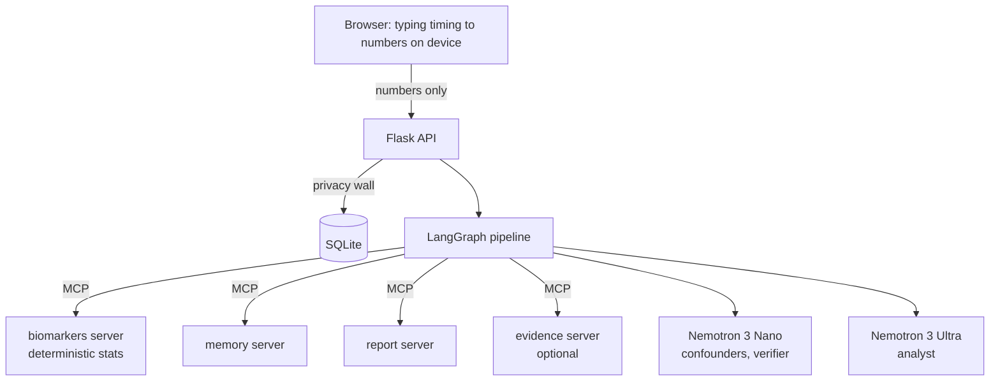

# NeuroShield

NeuroShield is a privacy-first assistant that watches *how* a person types, never *what* they type. It builds a baseline from the person's own typing, compares recent weeks against it, and flags a sustained change that may be worth mentioning to a clinician.

It runs on Nebius Token Factory with NVIDIA Nemotron models. Built for the Nebius x NVIDIA Global AI Hackathon, Personal AI track.

> NeuroShield is a screening-support tool, not a diagnostic device. Nothing it produces is a diagnosis.

## How it works



1. The browser turns typing into numbers (key timing, pauses, word counts, lexical diversity). The typed text stays on the device.
2. The Flask API accepts only the fields defined in `backend/schemas.py` and rejects everything else.
3. `backend/stats.py` compares recent behaviour with the person's own baseline (robust z-scores, Mann-Kendall trend, CUSUM change detection). Every number comes from this code, not from a model.
4. If the signal is calm, a fixed template is used and no model is called. Otherwise a LangGraph pipeline runs: `load_screen → confounder_review → analyst → verify (revise loop) → safety_guard → build_report`.
5. Guardrails in `backend/guardrails.py` check every number the analyst quotes against the screen, cap the recommendation level, and block diagnostic wording. If verification keeps failing, a safe template is shown and the result is flagged for human review.

## Models and infrastructure

| Role | Model | Used for |
|---|---|---|
| Analyst | Nemotron 3 Ultra | Interprets the screen for the person and the clinician (once per analysis) |
| Fast | Nemotron 3 Nano | Confounder review, verification, JSON repair, daily check-in |

Both are called through the OpenAI-compatible Nebius Token Factory API (`langchain_openai.ChatOpenAI`). If Ultra is rate-limited or times out, Nano finishes the analysis and the result says so. Agents are built with `langchain.agents.create_agent` and get their tools from MCP servers built with FastMCP: biomarkers, memory and report, plus an optional evidence server.

## Privacy

- Only the numeric fields in `backend/schemas.py` and three strictly validated identifiers are accepted. Anything else is rejected with HTTP 400.
- Raw typed text is never sent and never logged.
- The one exception is the optional daily check-in. The person's reply goes to a model to be scored, so it needs the person's opt-in and can be disabled for the whole server with `NEUROSHIELD_CHECKIN_CONSENT=false`. Only the numeric score and a short plan note (stored locally) are kept. To keep even this on your machine, point `NEUROSHIELD_CHECKIN_BASE_URL` at a local OpenAI-compatible server such as Ollama.
- `DELETE /api/users/<id>` erases everything stored for a person, and `GET /api/users/<id>/export` returns a copy.

## Features

- **Web app:** consent and onboarding, journal (typing is measured in the browser), daily check-in, summary, a privacy inspector that shows exactly what would be sent, and a printable clinician report.
- **Time-Travel Lab:** replay a person's history day by day. The screen at the chosen day is instant and needs no model. "Run analysis" starts the full pipeline as a background job.
- **Run audit:** every analysis keeps a trace of its steps, model calls, tokens and estimated cost.
- **Evaluation page:** measured false-alarm rate, detection rate and delay on simulated people, with confidence intervals and stated limits.
- **Always-on Watch:** a background loop that re-screens everyone on a schedule and notifies only when a signal changes. It makes no model calls unless you turn on auto-analyze.
- **Background reading:** the clinician report can list real papers found by a live Tavily search. Links are never written by a model.
- **Speed and cost controls:** identical analyses are cached, duplicate requests join the one already running, concurrent model calls are capped, and the screen sent to a model is compacted.

## Evaluation

Run with `python scripts/run_evaluation.py` (about half a minute). Results on 300+ simulated people:

| Question | Result |
|---|---|
| Healthy people ever flagged | 0 of 60 (95% CI up to 6%) |
| Subtle decline caught | 30 of 30, median 42 days after onset |
| Demo-strength decline caught | 30 of 30, median 30 days after onset |
| Very subtle decline caught | 6 of 30 (a real sensitivity limit) |
| Flu mistaken for decline while ill / still flagged after recovery | 2 of 30 / 1 of 30 |
| New keyboard recognised as mechanical-only | 30 of 30 |

The people are simulated, and the simulator and thresholds were developed together, so these figures are optimistic. They show the method behaves as designed. They are not clinical validation.

## Getting started

Requirements: Python 3.12, Node.js 20 or newer, and a Nebius Token Factory API key.

```bash
python -m venv .venv
source .venv/bin/activate                # Windows: .venv\Scripts\activate
pip install -r requirements.txt

cp .env.example .env                     # then set NEBIUS_API_KEY
python scripts/verify_token_factory.py   # confirms model IDs and tool calling

cd frontend && npm install && npm run build && cd ..
python scripts/seed_demo_data.py         # four fictional demo people
python run_all.py                        # MCP servers + Flask + web app on http://127.0.0.1:5000
```

For hot reload while working on the UI, keep `python run_all.py` running and start `npm run dev` in `frontend/` (http://localhost:5173, which proxies `/api` to Flask).

To start the pieces separately, run `python run_mcp_servers.py` in one terminal and `python -m backend.app` in another. To run one analysis from the command line: `python scripts/run_analysis_cli.py arthur_demo [YYYY-MM-DD]`.

### For judges: a 2-minute tour

1. Open the app. On the welcome page, pick any fictional demo person (no sign-up needed).
2. Today shows a demo guide for that person. Read **My Summary** for the plain-language view.
3. Open the **Clinician console** (header link, or the card at the bottom of Today) and go to the **Time-Travel Lab**: move through the person's history and run an analysis with the Nemotron models.
4. Open **Analysis Run** for the full audit trail and **Clinician Report** for the generated report.
5. Switch people with the menu at the top right to compare Arthur (real decline) against Mary (steady), John (flu) and Grace (new keyboard).

### Demo people

All four are fictional, with 90 days of generated history.

| Person | Situation | Expected result on day 90 |
|---|---|---|
| `arthur_demo` | Gradual multi-domain decline | Sustained multi-domain drift, suggest a routine check-up |
| `mary_demo` | Healthy | Stable |
| `john_demo` | Flu on days 70-76 | Acute change on day 75, calm after recovery |
| `grace_demo` | New keyboard on day 50 | Motor-only change (device artefact) |

Use the Time-Travel Lab, or pass `as_of` to the API, to watch the system react on different days.

## Configuration

Everything is set through environment variables or `.env`. See `.env.example` for the full list. The ones you are most likely to change:

| Variable | Purpose |
|---|---|
| `NEBIUS_API_KEY` | Token Factory key (required) |
| `NEUROSHIELD_MODEL_ANALYST`, `NEUROSHIELD_MODEL_FAST` | Model IDs for the two roles |
| `NEUROSHIELD_FLASK_HOST`, `NEUROSHIELD_FLASK_PORT` | Where the app listens (`0.0.0.0` when deploying) |
| `NEUROSHIELD_DB_PATH` | SQLite file location |
| `NEUROSHIELD_CHECKIN_CONSENT` | `false` disables the check-in for everyone |
| `NEUROSHIELD_CHECKIN_BASE_URL` | Run the check-in on a local model |
| `NEUROSHIELD_MAX_CONCURRENT_ANALYSES` | Cap on simultaneous model-backed analyses |
| `NEUROSHIELD_WATCHER`, `NEUROSHIELD_WATCHER_INTERVAL_MINUTES` | Turn the always-on Watch on and set its schedule |
| `TAVILY_API_KEY` | Enables background reading in the clinician report |

## API

| Method | Path | Purpose |
|---|---|---|
| GET | `/api/health` | Status, configured models, MCP URLs |
| GET | `/api/privacy/contract` | Exactly what may leave the device |
| GET, POST | `/api/users` | List people, create a person |
| GET, DELETE | `/api/users/<id>` | Read or erase a person |
| GET | `/api/users/<id>/export` | Everything stored for a person |
| GET | `/api/demo/personas` | The fictional demo people |
| POST | `/api/demo/seed` | Create the demo people |
| POST | `/api/ingest/validate` | Dry run of the privacy wall, stores nothing |
| POST | `/api/ingest` | Send one payload or `{"sessions": [...]}` |
| GET | `/api/users/<id>/series?as_of=` | Daily means for charts |
| GET | `/api/users/<id>/screen` | Deterministic screen only (no model) |
| GET | `/api/users/<id>/overview` | Data the person-facing pages need |
| POST | `/api/users/<id>/analyze` | Run the pipeline and wait (`{"as_of": "YYYY-MM-DD"}`) |
| POST | `/api/users/<id>/analyze/async` | Start the pipeline as a background job |
| GET | `/api/jobs/<job_id>` | Job status and progress events |
| GET | `/api/users/<id>/analysis/latest` | Last result |
| GET | `/api/users/<id>/runs`, `/api/runs/<run_id>` | Run history and one run's audit trail |
| POST | `/api/users/<id>/checkin`, `/api/users/<id>/checkin/reply` | Daily check-in |
| GET | `/api/users/<id>/plans` | Plans remembered by the check-in |
| DELETE | `/api/users/<id>/plans/<memory_id>` | Forget one plan |
| GET | `/api/users/<id>/notifications` | Watch notifications |
| POST | `/api/users/<id>/notifications/<notification_id>/read` | Mark a notification read |
| GET | `/api/watch/status` | Watch state |
| POST | `/api/watch/scan` | Run a Watch scan now |
| GET | `/api/evaluation` | Stored evaluation results |

## Project layout

```
backend/
  app.py            Flask API and static hosting for the built web app
  schemas.py        Data contract (the privacy wall) and metric catalogue
  stats.py          Deterministic statistics engine
  synthetic.py      Fictional demo people
  evaluation.py     Benchmark on simulated people
  guardrails.py     Policy, number verification, wording checks, templates
  graph/            LangGraph pipeline (state, nodes, compaction)
  agents/           Agent factory, prompts, schemas, check-in assistant
  mcp_servers/      biomarkers, memory, report and evidence MCP servers
  storage.py        SQLite layer
  jobs.py           Background jobs
  watcher.py        Always-on Watch
  llm.py            Token Factory models and usage tracking
frontend/           React, Vite and Tailwind web app
scripts/            Seed data, evaluation, CLI analysis, Token Factory check
tests/              Backend tests (real MCP servers, scripted models)
data/               SQLite database (created at runtime) and evaluation.json
```

## Tests

```bash
pytest -q                    # backend; needs no network or API key
cd frontend && npm test      # web app render tests with a mocked API
```

Every process also writes logs to `logs/<component>.log`.

## Deployment notes

- Build the web app first (`npm run build`). `python run_all.py` then starts the four MCP servers and serves the app and API from one Flask process.
- Set `NEUROSHIELD_FLASK_HOST=0.0.0.0` and `NEUROSHIELD_FLASK_PORT` to the port your platform expects.
- Keep `data/` on persistent storage, because it holds the SQLite database.
- The app has no authentication, CORS is open, and `/api/demo/seed` and `DELETE /api/users/<id>` are public. That is fine for a demo with fictional data. Put it behind authentication or a reverse proxy before it holds real people's data.
- `run_all.py` uses Flask's built-in server. Use a production WSGI server if you expect real traffic.
- Here the database sits on the server. In a real product it would live on the person's device, so only numbers would reach the server and the models.

## Limitations

- Screening support only. It does not diagnose anything.
- The baseline is the first four weeks of data, so a decline that starts inside that window is invisible.
- The thresholds are screening heuristics, not validated clinical cut-offs, and the evaluation used simulated people only.
- Very subtle declines are mostly missed (6 of 30 in the evaluation).
- `langchain.mcp` is in beta. `backend/mcp_client.py` is the only file that imports it.

## Licence

MIT. See `LICENSE`.

## Hackathon submission notes

**Track:** Personal AI.

**NVIDIA models used:** Nemotron 3 Ultra (analyst, deep reasoning) and Nemotron 3 Nano (confounder review, verification, JSON repair, daily check-in).

**Where Nebius Token Factory helped:** both models are served through one OpenAI-compatible endpoint, so the same `ChatOpenAI` client drives the Ultra and Nano roles. Per-call latency, tokens and estimated cost are recorded for every run (see the Analysis Run page). Ultra is used once per analysis and Nano handles the frequent cheap calls, which keeps credits low.

**Other Nebius tools:** none beyond Token Factory. The app is packaged as a single container (`Dockerfile`) and can be moved to Nebius Serverless Endpoints.

**Existing work:** this project was built during the submission period.

### Feedback on Nebius Token Factory and NVIDIA tools

- Token Factory: _add your own notes here (setup, latency, rate limits, docs)._
- Nemotron models: _add your own notes here (tool calling, JSON reliability, reasoning quality)._

## Deploy for free (Hugging Face Spaces)

See `DEPLOY.md`.
